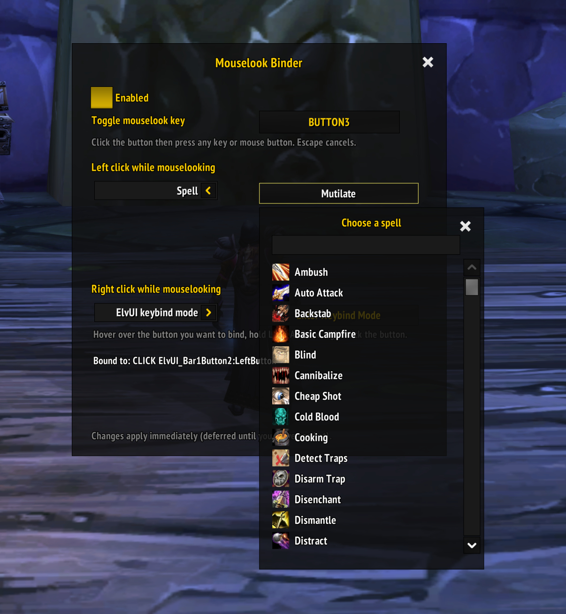
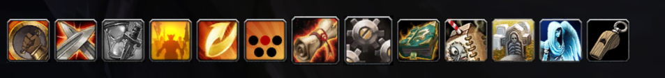
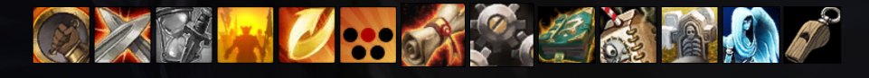
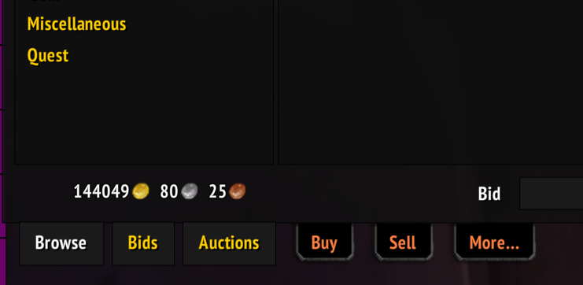
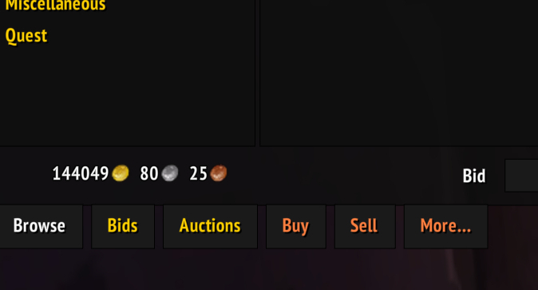
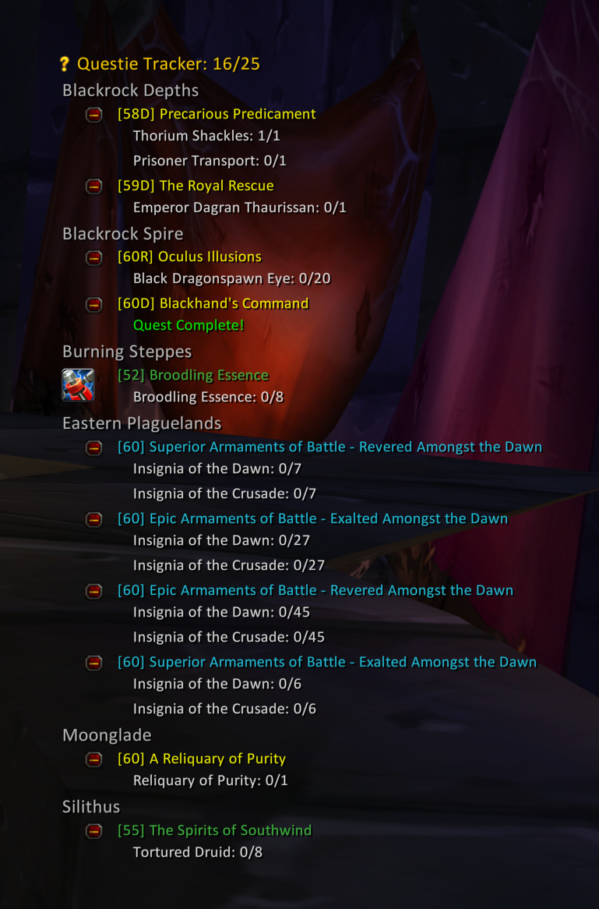
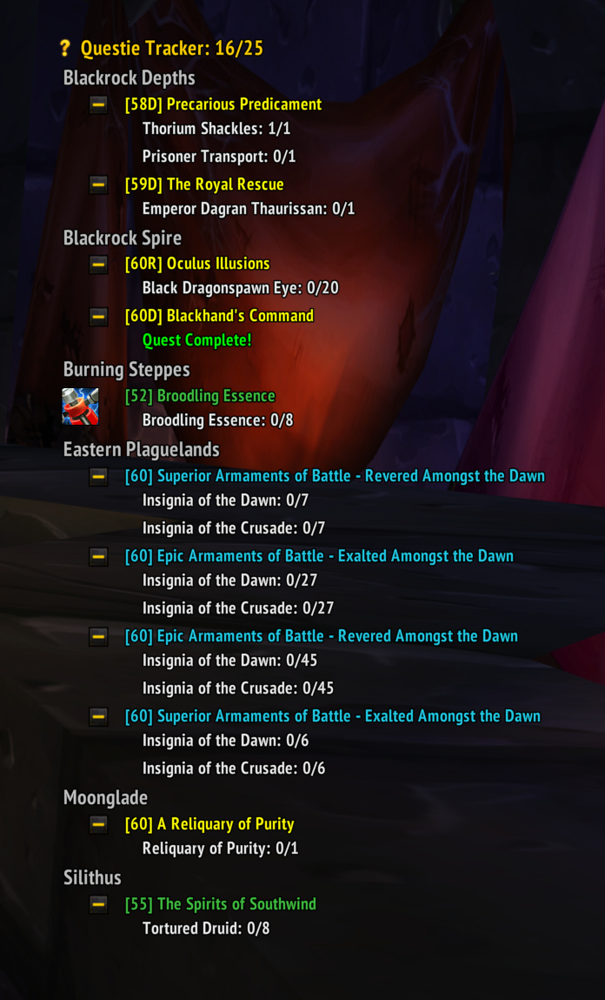
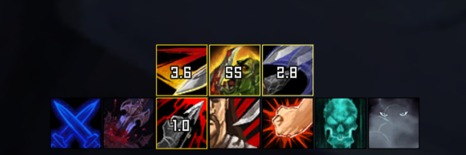

# WoW 3.3.5a Addons

A collection of new addons for WoW 3.3.5a.

Note: These were all vibe coded, it's an old game and I don't anticipate a long maintenance lifecycle. They are considered finished so code-quality is not relevant. You can still report issues/feature requests though.

## 1. MouselookBinder

Since I started playing in 2007 I've used a button to toggle mouselook and a bunch of macros to manage it. That is now an addon.

This lets you:

- Bind a key to mouselook (default to middle mouse `BUTTON3`)
- Assign a different action to left/right mouse when mouse looking. Left click can be used for a macro/spell while you are mouselooking, while still retaining its original cursor click functionality when you are not. The same thing for right click.

Importantly, while you are not mouselooking the default left/right click behaviour is entirely retained.

### Usage

Type `/mlb` and assign a keybind to toggle mouse look. Then select what you want to rebind left click/right click to.

Example: For my rogue I have middle mouse bound to toggle mouselook, then left click as `Mutilate` and right click as `Kick` while mouse looking.

### ElvUI integration

If you are using ElvUI (not required!) also install `MouselookBinder_ElvUI` then you can bind the shortcut to an action button using the inbuilt keybind mode.

Go into keybind mode and hold `Alt` then left or right click on an action button to bind the mouselooking action.

## 2. DynamicFarclip

Dynamically adjusts `farclip` based on framerate to a target framerate. A bit like the old ZoneFarclip addon but smarter. It dynamically adjusts your farclip value to meet an FPS target.

### Usage

- `/dfc` - show help/options
- `/dfc min` and `/dfc max` - Set the minimum and maximum possible farclip values
- `/dfc target [num]` - Set your FPS target e.g. `/dfc target 144`

## 3. ElvUI_MultiBot

Adds ElvUI button styling to the MultiBot addon.

### Before

### After

## 4. ElvUI_AuctionatorTabs

Fixes the missing ElvUI styling from `ElvUI_AddOnSkins` so that Auctionator tabs are properly skinned.

### Before

### After

## 5. ElvUI_QuestieTracker

Styles Questie quest tracker buttons/fonts/icons using your ElvUI settings.

### Before

### After

## 6. ElvUI_InlineAuraBridge

Adds support for `InlineAura` to ElvUI, allowing you to see your own buff times on icons. E.g. `Slice and Dice` or `Hunger For Blood` in the screenshot below. This is the time remaining on the buff so you know when it needs refreshing.

**Note: the InlineAura addon is included in this repo since it is difficult to find. It is not my work, only the ElvUI integration is.**

